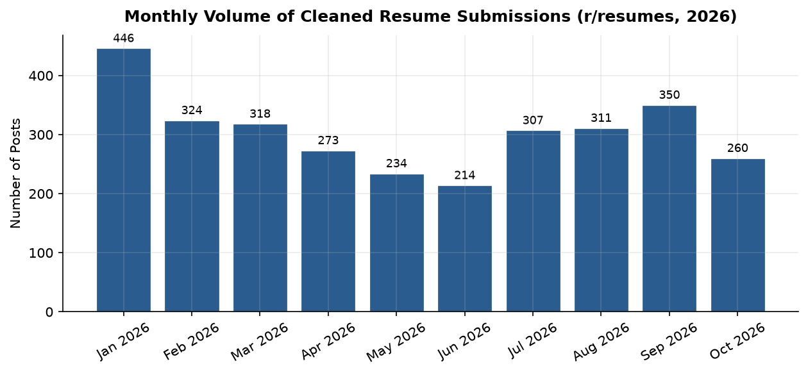
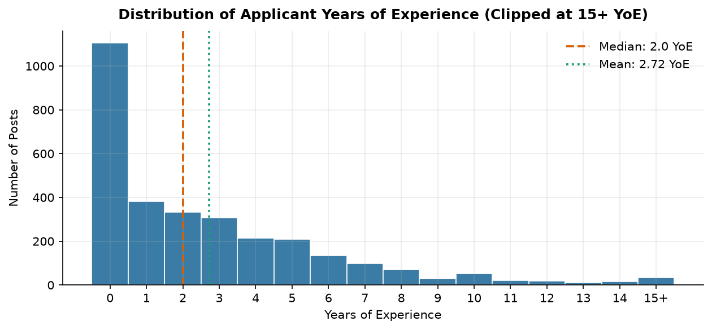
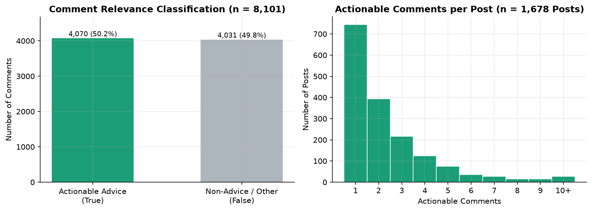

# Reddit Resume Dataset

[](https://www.python.org/downloads/)
[](data/final/)
[](https://github.com/saakethk/deepsift)

An open, structured dataset of **3,037 resume review submissions** and **8,101 labeled peer-critique comments** curated from Reddit (`r/resumes`, Jan 1 – Oct 31, 2026) using [deepsift](https://github.com/saakethk/deepsift).


---

## Why This Dataset?

Publicly available datasets that pair real-world resumes with structured applicant metadata and actionable human feedback are notoriously hard to find due to privacy concerns, paywalls, and inconsistent formatting. This repository turns public `r/resumes` discussions into a clean, research-ready corpus for:

- **Resume Evaluation & Critique Modeling** — Training and benchmarking models that generate resume feedback or distinguish actionable advice from general chatter.
- **Labor Market & Career-Transition Research** — Analyzing experience distributions, geographic mobility, and current-to-target occupation transitions.
- **Scraping & Curation Benchmarking** — Stress-testing the [deepsift](https://github.com/saakethk/deepsift) Reddit collection and filtering pipeline.

---

## Quick Start

### Load the Dataset
```python
import pandas as pd

posts = pd.read_parquet("data/final/posts.parquet")
comments = pd.read_parquet("data/final/comments.parquet")
soc = pd.read_csv("data/reference/amended_soc_structure.csv")

# Join actionable resume-advice comments to posts
advice = comments[comments["is_relevant"]].merge(
    posts, left_on="post_id", right_on="id", suffixes=("_comment", "_post")
)
```

### Run the Pipeline for Any Time Period
```bash
source venv/bin/activate

# Scrape, filter, normalize, and classify posts + comments for any date range
python -m src.pipeline --from-dt 2026-01-01 --to-dt 2026-11-01 --subreddit resumes
```

<details>
<summary>CLI options & prerequisites</summary>

- **Prerequisites:** Python 3.11+, [Ollama](https://ollama.com/) with `gemma4:e4b-mlx` (for role/comment classification), and Reddit API credentials in `.env` (see [`.env.example`](.env.example), only needed when scraping new data).
- `--skip-scrape` — Re-run cleaning and normalization on existing `data/raw/` Parquet files.
- `--skip-comments` — Only output `posts.parquet`.
- `--output-dir`, `--raw-dir`, `--intermediate-dir`, `--model` — Override default directories or the Ollama model.

</details>

---

## Dataset Overview

The processed dataset lives in [`data/final/`](data/final/) alongside the occupation lookup table in [`data/reference/`](data/reference/):

| File | Shape | Description |
| :--- | :--- | :--- |
| [`data/final/posts.parquet`](data/final/posts.parquet) | `3,037 × 12` | Cleaned resume posts with parsed YoE, normalized country, and SOC role codes |
| [`data/final/comments.parquet`](data/final/comments.parquet) | `8,101 × 8` | Non-AutoModerator comments across 1,941 posts with `is_relevant` advice labels |
| [`data/reference/amended_soc_structure.csv`](data/reference/amended_soc_structure.csv) | `1,474 × 5` | 2018 U.S. BLS SOC hierarchy extended with custom `99-*` transition/student codes |

<details>
<summary>Column schemas for posts.parquet and comments.parquet</summary>

#### `posts.parquet`
| Column | Type | Description |
| :--- | :--- | :--- |
| `created_utc` | int64 | Unix timestamp of post creation |
| `id` | string | Reddit submission ID |
| `num_comments` | int64 | Total comment count at scrape time |
| `score` | int64 | Net Reddit upvotes |
| `selftext` | string | Author-provided post context |
| `subreddit` | string | Source subreddit (`resumes`) |
| `title` | string | Original post title |
| `url` | string | Direct URL to resume image (`.png` or `.jpeg`) |
| `yoe` | float64 | Parsed years of experience (median: `2.0`, mean: `2.72`, range: `0.0–45.0`) |
| `current_role` | string | Standardized 2018 SOC (or `99-*`) detailed occupation code |
| `target_role` | string | Standardized 2018 SOC (or `99-*`) detailed occupation code |
| `country` | string | Normalized country or work-mode label (e.g., `United States`, `India`, `Remote`) |

#### `comments.parquet`
| Column | Type | Description |
| :--- | :--- | :--- |
| `id` | string | Reddit comment ID |
| `post_id` | string | Parent submission ID (joins with `posts.id`) |
| `parent_id` | string | Parent Reddit fullname ID (`t3_*` or `t1_*`) |
| `author` | string | Commenter username (`AutoModerator` excluded) |
| `body` | string | Comment text |
| `score` | int64 | Net Reddit upvotes |
| `created_utc` | int64 | Unix timestamp of comment creation |
| `is_relevant` | bool | `True` (4,070) if actionable resume advice; `False` (4,031) otherwise |

</details>

---

## Methodology

### 1. Collection & Filtering Funnel (`20,827 → 3,037` posts)
Initial subreddit discovery with PRAW identified `r/resumes` (1,328,408 subscribers) for its volume and structured title format. Using `deepsift`, we scraped all posts with `>= 1` comment from Jan 1 to Nov 1, 2026 and applied a 4-stage filter ([`src/clean.py`](src/clean.py)):

| Stage | Filter Criterion | Remaining | Retention |
| :--- | :--- | ---: | ---: |
| **Raw Scrape** | `r/resumes`, `num_comments >= 1` | 20,827 | 100.0% |
| **Valid Body** | Non-empty `selftext`, excluding `[removed]` / `[deleted]` | 9,658 | 46.4% |
| **Resume Image** | `url` ending in `.png` or `.jpeg` | 9,215 | 44.2% |
| **Structured Title** | Matches `[X YoE, Current Role, Target Role, Country]` | 8,512 | 40.9% |
| **Normalized** | Valid numeric `yoe`, `country` `< 26` chars, non-null mappings | **3,037** | **14.6%** |

### 2. Country & Work-Mode Normalization
[`src/country.py`](src/country.py) normalizes 1,408 unique raw location strings using deterministic regex rules—handling noise phrases, work-mode tags (`Remote`, `Hybrid`, `Global / Anywhere`), relocation arrows (`A -> B`), macro-regions (`Europe / EU`, `APAC`, `LATAM`), and sub-national cities/states.

### 3. Role Standardization (Amended 2018 SOC + LangGraph Classifier)
Official labor taxonomies omit non-occupational statuses common on resumes. We extended the 2018 U.S. BLS SOC table ([`data/reference/soc_structure_2018.xlsx`](data/reference/soc_structure_2018.xlsx)) with Major Group **`99-0000` (*Non-Occupational and Transition Statuses*)**, adding 13 detailed codes (`99-1011` through `99-5011`) for statuses like *Unemployed*, *Laid Off*, *Enrolled Student*, *Intern*, *Recent Graduate*, *Career Break*, and *Freelancer*.

[`src/classify.py`](src/classify.py) (`JobClassifier`) standardizes 7,784 unique role strings via a 3-node **LangGraph** workflow backed by **Ollama (`gemma4:e4b-mlx`, temperature `0.0`)** with Pydantic `Literal`-constrained outputs (`step1_major` → `step2_detailed` → `step3_lookup`).

### 4. Comment Extraction & Advice Filtering
We scraped 11,141 non-deleted comments for the filtered posts via `deepsift`, removed `AutoModerator` notices (**8,101** remaining across 1,941 posts), and labeled `is_relevant` in [`src/comments.py`](src/comments.py) using `gemma4:e4b-mlx` to separate actionable resume feedback (**4,070**) from general discussion, questions, or solicitations (**4,031**).

---

## Exploratory Data Analysis

Full analysis and plotting code are available in [`notebooks/09_exploratory_data_analysis.ipynb`](notebooks/09_exploratory_data_analysis.ipynb).

- **Steady Temporal Coverage:** Submissions span Jan–Oct 2026, peaking in January (`446` posts) and September (`350` posts).
- **Early-Career Skew:** Median experience is **`2.0` YoE** (25th percentile `0.0`, 75th percentile `4.0`, mean `2.72`).
- **Geographic Concentration:** Top locations are **United States** (`57.3%`), **India** (`10.7%`), **Canada** (`8.2%`), **Remote** (`4.7%`), and **United Kingdom** (`4.5%`).
- **Role Transitions:** Top current statuses are **Unemployed (`99-1011`, 784)**, **Software Developers (`15-1252`, 307)**, and **Recent Graduate (`99-2021`, 186)**; top target roles are **Software Developers (`15-1252`, 680)** and **Data Scientists (`15-2051`, 155)**.
- **Feedback Density:** **1,678** posts have at least one actionable advice comment, averaging **`2.43`** actionable comments per post.

| Monthly Submission Volume | Years of Experience Distribution |
| :---: | :---: |
|  |  |

| Top Locations & Work Modes | Comment Relevance & Density |
| :---: | :---: |
|  |  |


---

## Repository Structure

```text
resume_dataset/
├── .env.example                 # Reddit API credential template
├── .gitignore
├── README.md
├── data/
│   ├── final/                   # Final cleaned datasets (posts.parquet, comments.parquet)
│   ├── raw/                     # Raw deepsift scrapes
│   ├── intermediate/            # Extracted & normalized lookup tables
│   └── reference/               # Official & amended 2018 SOC taxonomies
├── figures/                     # EDA charts & Kaggle banner
├── notebooks/                   # Ordered exploration, development, and EDA notebooks (01–09)
└── src/                         # Modular scraping, cleaning, and classification pipeline
    ├── classify.py              # LangGraph + Ollama SOC role classifier
    ├── clean.py                 # Post filtering, extraction, and normalization
    ├── comments.py              # Comment filtering and advice relevance classifier
    ├── country.py               # Regex country & work-mode normalizer
    ├── pipeline.py              # End-to-end CLI & Python pipeline runner
    └── scraper.py               # deepsift wrappers
```

---

## Limitations

- **Platform Bias:** `r/resumes` skews toward English-speaking, early-career, and tech-oriented applicants.
- **Image-Based Resumes:** Resume content is stored as `.png`/`.jpeg` URLs rather than pre-extracted text (downstream parsing requires OCR or vision-language models).
- **Automated Labels:** Role codes and `is_relevant` comment labels rely on zero-temperature `gemma4:e4b-mlx` inference and may contain occasional misclassifications.

---

## Author

Created by **Saaketh Kesireddy** — powered by [deepsift](https://github.com/saakethk/deepsift).
