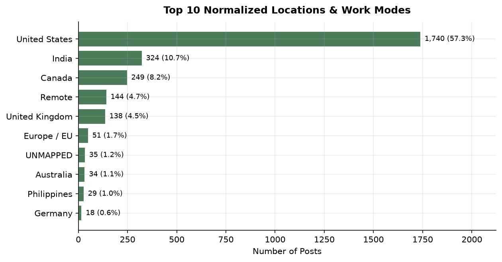
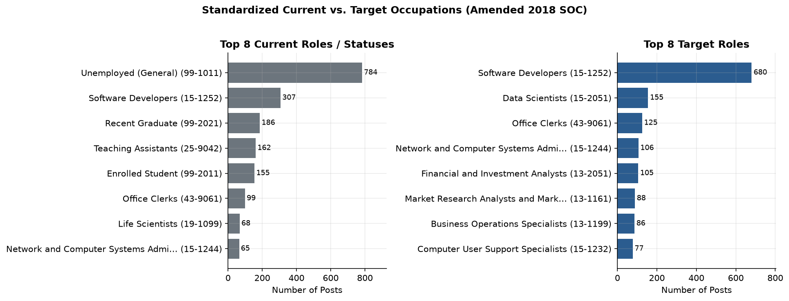

# Curating an Empirical Resume & Peer-Critique Dataset from Reddit

**Abstract.** Publicly available datasets pairing real-world resumes with structured career metadata and actionable human critique are scarce due to privacy constraints, proprietary paywalls, and inconsistent formatting. To address this gap, we introduce the **Reddit Resume Dataset**, an empirical corpus of **3,037** standardized resume submissions and **8,101** annotated peer-review comments collected from `r/resumes` between January 1, 2026 and October 31, 2026 using [deepsift](https://github.com/saakethk/deepsift). We detail a reproducible multi-stage curation pipeline combining deterministic regex filtering, rule-based geographic normalization, an amended 2018 Standard Occupational Classification (SOC) taxonomy with a hierarchical LangGraph LLM classifier, and automated comment-relevance labeling.

---

## 1. Introduction & Motivation

Research on automated resume evaluation, career-path modeling, and labor-market trends is frequently bottlenecked by the lack of open, structured datasets. Existing corpora typically suffer from one or more limitations: they are proprietary, lack ground-truth human feedback, omit structured applicant context (such as years of experience or target occupation), or are restricted to narrow synthetic templates.

Online peer-review communities—most notably Reddit's `r/resumes` (1,328,408 subscribers at the time of collection)—offer a rich, naturally occurring alternative. Submitters routinely share anonymized resume images alongside standardized title metadata and receive targeted critique from peers and recruiters. This project formalizes that public discourse into a clean, research-ready dataset designed to support:

1. **Resume Evaluation & Feedback Modeling** — Training and benchmarking models that critique resumes or distinguish actionable feedback from general discussion.
2. **Labor Market & Career-Transition Analysis** — Studying experience distributions, geographic mobility, and current-to-target occupation transitions.
3. **Scraping & Curation Benchmarking** — Stress-testing the `deepsift` Reddit collection and filtering library.

---

## 2. Data Collection & Filtering Methodology

### 2.1 Source Selection & Raw Acquisition
Initial subreddit discovery was conducted using PRAW, identifying `r/resumes` as the highest-volume, most consistently structured public forum for resume critique. Using `deepsift`, we scraped all submissions with at least one comment (`num_comments >= 1`) published between **January 1, 2026 and November 1, 2026**, yielding **20,827** raw posts ([`data/raw/subreddit_resumes_posts.parquet`](data/raw/subreddit_resumes_posts.parquet)).

### 2.2 Multi-Stage Post Filtering Funnel
Raw Reddit submissions contain deleted posts, text-only questions, and non-standard titles. We applied a deterministic four-stage filtering funnel (implemented in [`src/clean.py`](src/clean.py) and [`notebooks/02_exploring_sample_data.ipynb`](notebooks/02_exploring_sample_data.ipynb)):

| Stage | Criterion | Remaining Posts | Retention |
| :--- | :--- | ---: | ---: |
| **0. Raw Scrape** | `r/resumes`, `num_comments >= 1` | 20,827 | 100.0% |
| **1. Valid Body Text** | Non-empty `selftext`, excluding `[removed]` and `[deleted]` | 9,658 | 46.4% |
| **2. Resume Image URL** | `url` ending in `.png` or `.jpeg` | 9,215 | 44.2% |
| **3. Structured Title** | Matches `r/resumes` convention `[X YoE, Current Role, Target Role, Country]` | 8,512 | 40.9% |
| **4. Parsed & Mapped** | Valid numeric `yoe`, `country` length `< 26`, and non-null SOC/country mappings | **3,037** | **14.6%** |

---

## 3. Normalization & Classification Methodologies

### 3.1 Geographic & Work-Mode Normalization
User-entered location strings (`data/intermediate/countries.csv`, 8,512 entries / 1,408 unique values) exhibit high lexical variance (e.g., `"NYC"`, `"Bay Area"`, `"U.S."`, `"Bengaluru"`, `"Anywhere"`). In [`src/country.py`](src/country.py) (developed in [`notebooks/03_developing_country_classifications.ipynb`](notebooks/03_developing_country_classifications.ipynb)), we apply a deterministic regex hierarchy:

1. **Noise Removal**: Filters non-location artifacts (e.g., `"unknown"`, `"seeking feedback"`).
2. **Work-Mode & Scope Tagging**: Prioritizes explicit work-mode indicators (`Remote`, `Global / Anywhere`, `Hybrid`) and relocation arrows (`A -> B` resolves to `B`).
3. **Regional & Country Matching**: Maps sub-national cities, states, and abbreviations to canonical country names (e.g., `United States`, `India`, `Canada`, `United Kingdom`) or macro-regions (`Europe / EU`, `APAC`, `LATAM`); unresolved strings are labeled `UNMAPPED`.

### 3.2 Occupational Standardization (Amended 2018 SOC + LangGraph Classifier)
Raw job titles (`current_role` and `target_role`) span **7,784** unique strings. Standardizing these against the official **2018 U.S. BLS Standard Occupational Classification (SOC)** ([`data/reference/soc_structure_2018.xlsx`](data/reference/soc_structure_2018.xlsx)) revealed a structural gap: official labor taxonomies assume active employment and lack codes for non-occupational statuses frequently reported on resumes (e.g., *Unemployed*, *New Grad*, *Enrolled Student*, *Career Break*).

To resolve this, we constructed [`data/reference/amended_soc_structure.csv`](data/reference/amended_soc_structure.csv) by appending Major Group **`99-0000` (*Non-Occupational and Transition Statuses*)** comprising 13 detailed codes (`99-1011` through `99-5011`), including:
- Employment transitions: `99-1011` (Unemployed), `99-1012` (Laid Off), `99-1021` (Looking for Work), `99-1022` (Career Break / Transition)
- Academic statuses: `99-2011` (Enrolled Student), `99-2012` (Intern / Co-op), `99-2021` (Recent Graduate)
- Alternative & open statuses: `99-3011` (Freelancer), `99-3012` (Self Employed / Founder), `99-4011` (Caregiver), `99-4012` (Volunteer), `99-4021` (Retired), `99-5011` (Anything / Undecided)

For classification, [`src/classify.py`](src/classify.py) (`JobClassifier`) implements a 3-node **LangGraph** pipeline backed by **Ollama (`gemma4:e4b-mlx`, temperature `0.0`)** with Pydantic `Literal`-constrained structured outputs:
1. **`step1_major`**: Classifies the raw role string into a single SOC Major Group.
2. **`step2_detailed`**: Selects the best Detailed Occupation within the chosen Major Group.
3. **`step3_lookup`**: Deterministically resolves Minor and Broad Group codes from the taxonomy table.

### 3.3 Comment Extraction & Actionable Advice Filtering
Using `deepsift`, we retrieved **11,141** non-deleted comments associated with the filtered posts ([`data/raw/subreddit_resumes_comments.parquet`](data/raw/subreddit_resumes_comments.parquet)). After removing automated `AutoModerator` notices, **8,101** comments remained across **1,941** unique posts.

Because many Reddit replies consist of clarifying questions, off-topic remarks, or paid-service solicitations rather than resume critique, [`src/comments.py`](src/comments.py) (`CommentAdviceClassifier`) uses `gemma4:e4b-mlx` with a boolean Pydantic schema (`ResumeAdviceCheck`) to assign `is_relevant = True` exclusively to comments offering actionable feedback on wording, formatting, sections, projects, skills, or role targeting.

---

## 4. Exploratory Data Analysis & Corpus Statistics

The final dataset in [`data/final/`](data/final/) comprises two Parquet tables covering **January 1, 2026 – October 31, 2026** (full analysis in [`notebooks/09_exploratory_data_analysis.ipynb`](notebooks/09_exploratory_data_analysis.ipynb)):

- **[`data/final/posts.parquet`](data/final/posts.parquet)** (`3,037 rows × 12 cols`): `created_utc`, `id`, `num_comments`, `score`, `selftext`, `subreddit`, `title`, `url`, `yoe`, `current_role`, `target_role`, `country`.
- **[`data/final/comments.parquet`](data/final/comments.parquet)** (`8,101 rows × 8 cols`): `id`, `post_id`, `parent_id`, `author`, `body`, `score`, `created_utc`, `is_relevant`.

### 4.1 Temporal Coverage
Monthly submission volume remains steady across the 10-month window, peaking in January 2026 (446 posts) and September 2026 (350 posts), consistent with seasonal hiring and academic recruiting cycles.


### 4.2 Experience Distribution
The corpus is heavily skewed toward early-career applicants: the **25th percentile is `0.0` YoE**, the **median is `2.0` YoE**, the **75th percentile is `4.0` YoE**, and the **mean is `2.72` YoE** (range: `0.0–45.0` YoE).


### 4.3 Geographic & Work-Mode Distribution
Submissions are concentrated in North America, South Asia, and Europe, led by the **United States** (1,740 posts, 57.3%), **India** (324, 10.7%), **Canada** (249, 8.2%), **Remote** (144, 4.7%), and the **United Kingdom** (138, 4.5%).



### 4.4 Occupational Transitions (Current vs. Target Roles)
Comparing `current_role` against `target_role` highlights the necessity of our `99-*` SOC extension: the #1, #3, and #5 most common current statuses are **Unemployed (`99-1011`, 784 posts)**, **Recent Graduate (`99-2021`, 186)**, and **Enrolled Student (`99-2011`, 155)**. On the target side, **Software Developers (`15-1252`, 680 posts)** and **Data Scientists (`15-2051`, 155)** dominate.



### 4.5 Comment Relevance & Feedback Density
Of the 8,101 non-AutoModerator comments, **4,070 (50.2%)** are classified as actionable resume advice (`is_relevant == True`) and **4,031 (49.8%)** as non-advice. Across the **1,678** posts that received at least one actionable comment, the mean is **2.43** actionable comments per post (median `2.0`, max `17`).


---

## 5. Limitations & Ethical Considerations

- **Platform & Self-Selection Bias**: `r/resumes` skews toward English-speaking, early-career, and technology-oriented job seekers; results should not be treated as a representative sample of the global labor force.
- **Image-Based Resumes**: Resume content is linked via external `.png`/`.jpeg` image URLs rather than extracted text, meaning downstream resume-parsing models require OCR or vision-language ingestion.
- **Automated Labeling Noise**: Role standardization (`JobClassifier`) and comment relevance (`CommentAdviceClassifier`) rely on zero-temperature `gemma4:e4b-mlx` inference and may contain occasional misclassifications.
- **Privacy**: All data is sourced from public Reddit submissions and comments; no private or personally de-anonymized records are included.

---

## 6. Reproducibility & Repository Structure

### Repository Layout

```text
resume_dataset/
├── .env.example                 # Template for Reddit API credentials
├── .gitignore
├── README.md
├── data/
│   ├── final/                   # Final cleaned & labeled dataset files
│   │   ├── posts.parquet
│   │   └── comments.parquet
│   ├── raw/                     # Raw scraped Reddit posts and comments
│   │   ├── subreddit_resumes_posts.parquet
│   │   └── subreddit_resumes_comments.parquet
│   ├── intermediate/            # Extracted and normalized lookup tables
│   │   ├── roles.csv
│   │   ├── normalized_roles.csv
│   │   ├── countries.csv
│   │   ├── normalized_countries.csv
│   │   └── comment_texts.csv
│   └── reference/               # Official & amended 2018 SOC taxonomies
│       ├── soc_structure_2018.xlsx
│       ├── soc_structure_2018.pdf
│       └── amended_soc_structure.csv
├── figures/                     # Publication-ready EDA figures
├── notebooks/                   # Ordered exploration, development, and EDA notebooks
│   ├── 01_exploring_subreddits.ipynb
│   ├── 02_exploring_sample_data.ipynb
│   ├── 03_developing_country_classifications.ipynb
│   ├── 04_developing_role_classifications.ipynb
│   ├── 05_testing_role_classifier.ipynb
│   ├── 06_finalizing_sample_data.ipynb
│   ├── 07_extracting_comments.ipynb
│   ├── 08_exploring_comments.ipynb
│   └── 09_exploratory_data_analysis.ipynb
└── src/                         # Modular end-to-end pipeline & classifiers
    ├── __init__.py
    ├── classify.py              # LangGraph + Ollama SOC role classifier
    ├── clean.py                 # Post filtering, extraction, and normalization
    ├── comments.py              # Comment filtering and advice relevance classifier
    ├── country.py               # Regex-based country and work-mode normalizer
    ├── pipeline.py              # End-to-end CLI & Python pipeline runner
    └── scraper.py               # deepsift wrappers for posts and comments
```

### Running the Pipeline for Any Time Period

```bash
source venv/bin/activate

# Scrape, filter, normalize, and classify posts + comments for any date range
python -m src.pipeline --from-dt 2026-01-01 --to-dt 2026-11-01 --subreddit resumes
```

Useful flags:
- `--skip-scrape` — Re-run cleaning/normalization on existing `data/raw/` parquet files without hitting Reddit.
- `--skip-comments` — Only produce `posts.parquet`.
- `--output-dir`, `--raw-dir`, `--intermediate-dir`, `--model` — Override default paths or the Ollama model.
